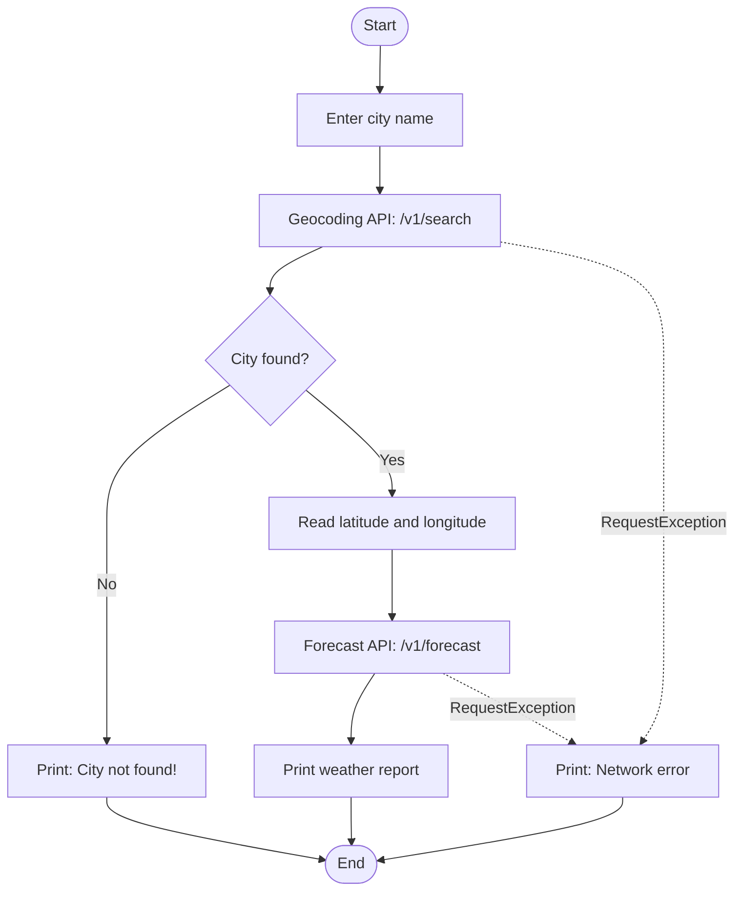

# 🌧️ Rainfall Prediction System


A small Python command-line application that tells you the **current weather and the chance of rain for any city**. Type a city name, and the program looks up its coordinates, fetches forecast data from the [Open-Meteo](https://open-meteo.com/) web services and prints a short weather report.

No API key, no database and no special hardware are needed.

> **What "prediction" means here:** the rain probability is produced by the ensemble weather-prediction models behind Open-Meteo. This project retrieves and presents that forecast. It does not train its own machine-learning model (see the [roadmap](#-roadmap)).

---

## ✨ Features

- 🔎 **Search by city name**: no need to know latitude and longitude.
- 🌡️ **Current conditions**: temperature (°C), relative humidity (%) and wind speed (km/h).
- ☔ **Rain probability**: precipitation probability (%) from the hourly forecast.
- 🕒 **Local time zone**: `timezone=auto` makes the time stamps follow the city's own time zone.
- 🛡️ **Robust error handling**: unknown cities, time-outs, connection failures and HTTP errors give a clear message instead of a crash.
- 🪶 **Lightweight**: one Python file and one dependency (`requests`).

---

## ⚙️ How it works



1. The user enters a city name.
2. The **Geocoding API** converts the name into latitude and longitude (best match only).
3. The **Forecast API** returns the current weather and the hourly precipitation probability for those coordinates.
4. The program prints the values as a weather report.
5. Any `requests.RequestException` (connection error, time-out, HTTP error) is caught and reported.

---

## 🚀 Getting started

### Prerequisites

- Python **3.8 or later**
- An Internet connection

### Installation

```bash
# 1. Clone the repository
git clone https://github.com/<your-username>/<your-repo-name>.git
cd <your-repo-name>

# 2. (Optional) create a virtual environment
python -m venv venv
source venv/bin/activate        # Windows: venv\Scripts\activate

# 3. Install the only dependency
pip install requests
```

### Run

```bash
python rainfall.py
```

Enter a city name when asked, for example `Chennai`.

### Example output

The values below are illustrative; the real numbers change with the live weather.

```text
Enter city name: Chennai

--- WEATHER REPORT ---
City: Chennai
Temperature: 29.4 C
Humidity: 78 %
Wind Speed: 12.6 km/h
Next Hour Rain Probability: 10 %
```

If the city is not recognised:

```text
Enter city name: Xyzabcdq
City not found!
```

If the network or the service is not reachable:

```text
Enter city name: Chennai
Network error: HTTPSConnectionPool(host='geocoding-api.open-meteo.com', port=443): Read timed out. (read timeout=15)
```

---

## 🔌 APIs used

Both services are provided by Open-Meteo and return JSON over HTTPS (HTTP GET).

### 1. Geocoding API

`https://geocoding-api.open-meteo.com/v1/search`

| Parameter  | Value              | Purpose                              |
|------------|--------------------|--------------------------------------|
| `name`     | city typed by user | Place name to search                 |
| `count`    | `1`                | Return only the best match           |
| `language` | `en`               | Names in English                     |
| `format`   | `json`             | JSON response                        |

### 2. Forecast API

`https://api.open-meteo.com/v1/forecast`

| Parameter       | Value                                                | Purpose                         |
|-----------------|------------------------------------------------------|---------------------------------|
| `latitude`, `longitude` | from the geocoding result                    | Location of the forecast        |
| `current`       | `temperature_2m,relative_humidity_2m,wind_speed_10m` | Present weather conditions      |
| `hourly`        | `precipitation_probability`                          | Hourly rain probability (%)     |
| `forecast_days` | `1`                                                  | One day of hourly data          |
| `timezone`      | `auto`                                               | Local time zone of the location |

Per the Open-Meteo documentation, `precipitation_probability` is the probability of more than 0.1 mm of precipitation in the *preceding hour*, based on ensemble models at 0.25° (about 27 km) resolution.

---

## 🧯 Error handling

Every request uses `timeout=15` and `raise_for_status()`, and all calls sit inside one `try` block.

| Situation                      | What the program prints                          |
|--------------------------------|--------------------------------------------------|
| City name not found            | `City not found!`                                |
| No Internet / server unreachable | `Network error: <details>`                     |
| No answer within 15 seconds    | `Network error: <details>`                       |
| HTTP error (for example 429)   | `Network error: <details>`                       |

---

## 📁 Project structure

```text
.
├── rainfall.py     # the application
└── README.md
```

---

## ⚠️ Known limitations

- **"Next Hour Rain Probability" is the first value of the day's hourly list.** With `forecast_days=1` and `timezone=auto`, the hourly series starts at 00:00 local time, so `rain[0]` is the midnight value and equals the next hour only if you run the program just after midnight. A fix is shown below.
- **Only the best match is used** (`count=1`). If several places share a name, you may get a different city than you meant. Adding the country to the name (for example `Paris, France`) helps.
- **Forecast resolution is about 27 km**, so very local showers may not be captured.
- **Needs Internet access** and depends on the availability of the Open-Meteo service.

### Suggested fix for the next-hour value

Change `"forecast_days": 1` to `2` in the forecast request, then replace the line that reads `rain[0]` with:

```python
cur_hour = current["time"][:13]                      # e.g. "2026-10-19T10"
times = data["hourly"]["time"]
idx = next(i for i, t in enumerate(times) if t.startswith(cur_hour))
next_hour_prob = rain[min(idx + 1, len(rain) - 1)]   # value for the coming hour

print("Next Hour Rain Probability:", next_hour_prob, "%")
```

---

## 🗺️ Roadmap

- [ ] Show the rain probability for the next several hours (and a chart)
- [ ] Multi-day forecast
- [ ] Machine-learning model trained on historical data (random forest, decision tree, neural network) compared with the forecast service
- [ ] Rain alerts by e-mail or message above a chosen threshold
- [ ] Web or desktop interface with a search box
- [ ] Country filter and a list of matching places
- [ ] Unit tests with mocked API responses

---

## 🛠️ Built with

- [Python](https://www.python.org/)
- [Requests](https://requests.readthedocs.io/)
- [Open-Meteo Geocoding API](https://open-meteo.com/en/docs/geocoding-api) and [Forecast API](https://open-meteo.com/en/docs)

---

## 📜 Data source and usage terms

Weather and geocoding data are provided by [Open-Meteo.com](https://open-meteo.com/) under the [CC BY 4.0](https://creativecommons.org/licenses/by/4.0/) licence, and location data come from [GeoNames](https://www.geonames.org/). Please credit Open-Meteo if you reuse the data.

The free Open-Meteo API is for **non-commercial use** only (this includes educational projects and public research). At the time of writing the free tier allows 600 calls per minute, 5,000 per hour and 10,000 per day; see the [Open-Meteo terms](https://open-meteo.com/en/terms) for current conditions.

---

## 👥 Authors

- **[Your Name]**: [GitHub profile link]
- **[Team member 2]**
- **[Team member 3]**

Developed as a course-end project, Department of Computer Science and Engineering, Velammal Engineering College, Chennai.

## 📄 License

Add a `LICENSE` file to the repository (for example MIT) and name it here.
